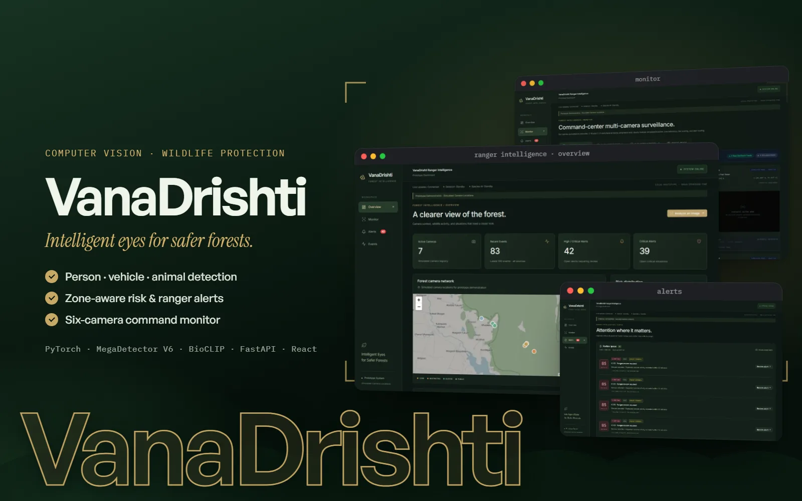
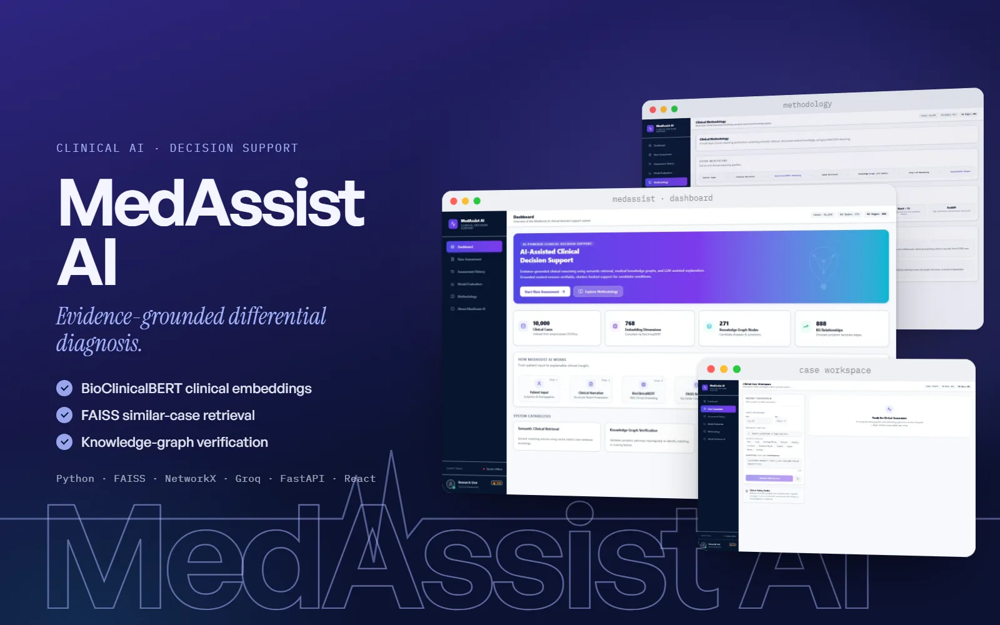
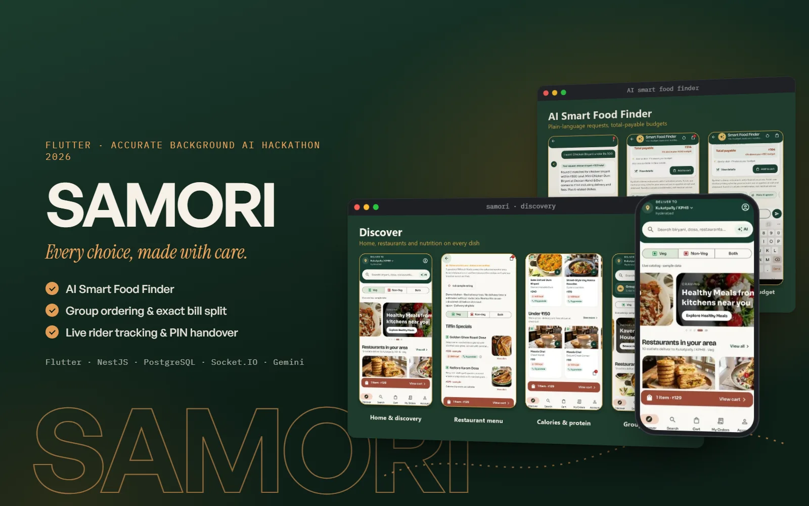

<!-- Header -->
<p align="center">
  
</p>

<p align="center">
  <a href="https://github.com/Raghuram1784">
    
  </a>
</p>

<p align="center">
  <a href="https://www.linkedin.com/in/ymvraghuram/"></a>
  <a href="https://github.com/Raghuram1784?tab=repositories"></a>
  
  
</p>

<br />

##  About me

<table>
<tr>
<td width="58%" valign="top">

I'm a final-year **B.Tech Computer Science and Engineering (Honors)** student at **KL University**, specializing in **Data Science and Big Data Analytics**.

I design and build **full-stack web apps**, **mobile apps** and **AI-powered systems**, from agentic commerce to wildlife protection and clinical AI.

- 💼 **Software Development Intern** at **Juvion Labs**
- 🧑‍🏫 **DSA Mentor** (part-time) at **Smart Interviews**
- 🔬 Research internships at **IIT Tirupati** and **NIT Warangal**
- 🎓 **CGPA 9.93 / 10**
- 🌱 Building with LLM agents, RAG and computer vision

</td>
<td width="42%" valign="top">

```ts
const raghuram = {
  basedIn: "Hyderabad, India",
  roles: [
    "Software Developer",
    "AI/ML Engineer",
    "Full-Stack & Mobile",
  ],
  now: [
    "Intern @ Juvion Labs",
    "DSA Mentor @ Smart Interviews",
  ],
  loves: ["AI products", "clean UX",
          "systems that ship"],
};
```

</td>
</tr>
</table>

## 🚀 Featured projects

<table>
<tr>
<td width="50%" valign="top">
<a href="https://github.com/Raghuram1784/Mercora-AI"></a>

### Mercora AI
Agentic commerce: shop by conversation, explicit authorization before checkout, server-verified Razorpay payments.

   

**[Code](https://github.com/Raghuram1784/Mercora-AI)** · **[Live demo](https://mercora-ai.vercel.app)**
</td>
<td width="50%" valign="top">
<a href="https://github.com/Raghuram1784/vanadrishti"></a>

### VanaDrishti
AI wildlife surveillance and ranger decision support: person, vehicle and animal detection with zone-aware risk alerts.

   

**[Code](https://github.com/Raghuram1784/vanadrishti)**
</td>
</tr>
<tr>
<td width="50%" valign="top">
<a href="https://github.com/Raghuram1784/MedAssist-AI"></a>

### MedAssist AI
Clinical decision support: evidence-grounded differential assessment with BioClinicalBERT, FAISS retrieval and a knowledge graph.

   

**[Code](https://github.com/Raghuram1784/MedAssist-AI)**
</td>
<td width="50%" valign="top">
<a href="https://github.com/Raghuram1784/FlowTwin-AI"></a>

### FlowTwin AI
Predictive workflow optimization: user journeys as a graph, bottleneck detection and abandonment-risk prediction.

   

**[Code](https://github.com/Raghuram1784/FlowTwin-AI)**
</td>
</tr>
<tr>
<td width="50%" valign="top">
<a href="https://github.com/Raghuram1784/Scan2Hire"></a>

### Scan2Hire
QR-powered career portal: student assessments, a unique QR code for every job and AI fitment scoring.

  

**[Code](https://github.com/Raghuram1784/Scan2Hire)** · **[Live demo](https://v0-kaizen-job-portal.vercel.app/)**
</td>
<td width="50%" valign="top">
<a href="https://github.com/Raghuram1784/smart_food_app"></a>

### SAMORI
AI-assisted, real-time food delivery for Hyderabad: one Flutter app for customers, restaurants, riders and admins.

   

**[Code](https://github.com/Raghuram1784/smart_food_app)**
</td>
</tr>
</table>

## 🧰 Tech stack

<p align="center">
  <b>Languages</b><br /><br />
  
</p>
<p align="center">
  <b>Frontend & mobile</b><br /><br />
  
</p>
<p align="center">
  <b>Backend & data</b><br /><br />
  
</p>
<p align="center">
  <b>AI / ML & tools</b><br /><br />
  
</p>

<p align="center">
        
</p>

## 🧭 Journey

| | Where | Role | When |
| :-: | :-- | :-- | :-- |
| 💼 | **Juvion Labs Private Limited**, Hyderabad | Software Development Intern | Sep 2026 – Present |
| 🧑‍🏫 | **Smart Interviews** | Data Structures & Algorithms Mentor (part-time) | Current |
| 🔬 | **IIT Tirupati** | Research Intern, Full-Stack & AI/ML Development | May – Jul 2026 |
| 🤖 | **NIT Warangal** | Machine Learning Research Intern | Jun – Jul 2025 |

## 📊 GitHub stats

<p align="center">
  
  
</p>

<p align="center">
  
</p>

<p align="center">
  
</p>

<p align="center">
  <picture>
    <source media="(prefers-color-scheme: dark)" srcset="https://raw.githubusercontent.com/Raghuram1784/Raghuram1784/output/snake-dark.svg" />
    
  </picture>
</p>

## 🤝 Let's connect

<p align="center">
  I'm always up for conversations about AI products, full-stack engineering and interesting problems.<br /><br />
  <a href="https://www.linkedin.com/in/ymvraghuram/"></a>
</p>

<!-- Footer -->
<p align="center">
  
</p>
