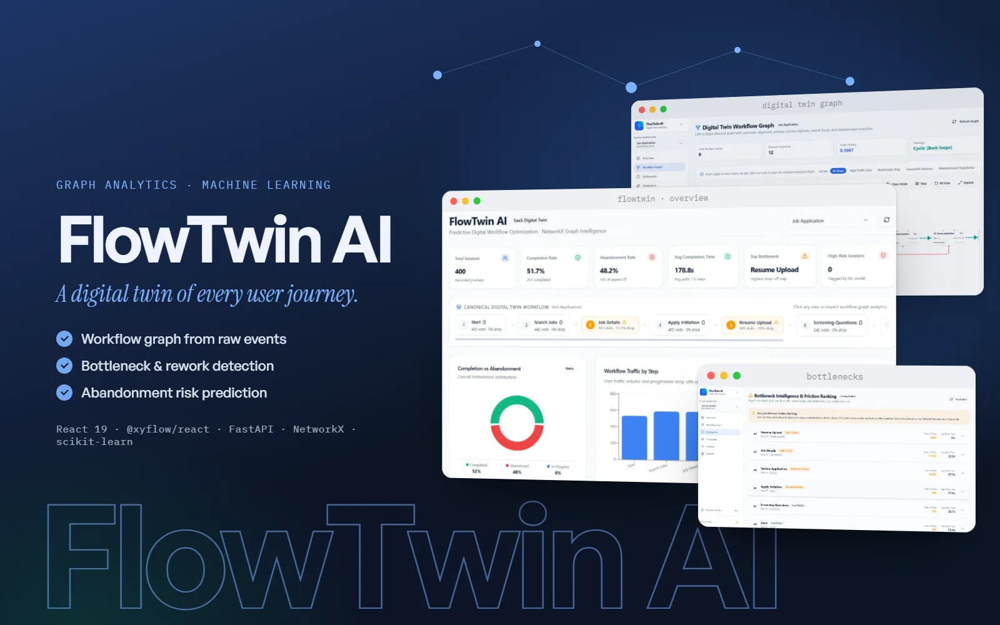
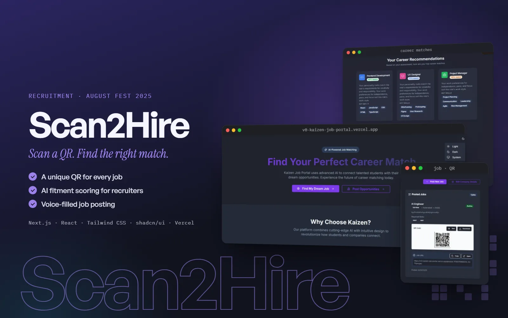

  

  

  
  
  
  

### Featured work

<table>
<tr>
<td width="33%" valign="top" align="center"><a href="https://github.com/Raghuram1784/Mercora-AI"> <b>Mercora AI</b></a> Agentic commerce · Razorpay      </td>
<td width="33%" valign="top" align="center"><a href="https://github.com/Raghuram1784/vanadrishti"> <b>VanaDrishti</b></a> Wildlife computer vision      </td>
<td width="33%" valign="top" align="center"><a href="https://github.com/Raghuram1784/MedAssist-AI"> <b>MedAssist AI</b></a> Clinical decision support      </td>
</tr>
<tr>
<td width="33%" valign="top" align="center"><a href="https://github.com/Raghuram1784/FlowTwin-AI"> <b>FlowTwin AI</b></a> Workflow graph analytics      </td>
<td width="33%" valign="top" align="center"><a href="https://github.com/Raghuram1784/Scan2Hire"> <b>Scan2Hire</b></a> QR career portal     </td>
<td width="33%" valign="top" align="center"><a href="https://github.com/Raghuram1784/smart_food_app"> <b>SAMORI</b></a> Real-time food delivery app      </td>
</tr>
</table>

### Toolkit

  

### GitHub at a glance

  
  

<b>My journey</b>

 

| Where | Role | When |
| :-- | :-- | :-- |
| **Juvion Labs**, Hyderabad | Software Development Intern | Sep 2026 – Present |
| **Smart Interviews** | DSA Mentor (part-time) | Current |
| **IIT Tirupati** | Research Intern, Full-Stack & AI/ML | May – Jul 2026 |
| **NIT Warangal** | Machine Learning Research Intern | Jun – Jul 2025 |

<picture>
  <source media="(prefers-color-scheme: dark)" srcset="https://raw.githubusercontent.com/Raghuram1784/Raghuram1784/output/snake-dark.svg" />
  
</picture>
