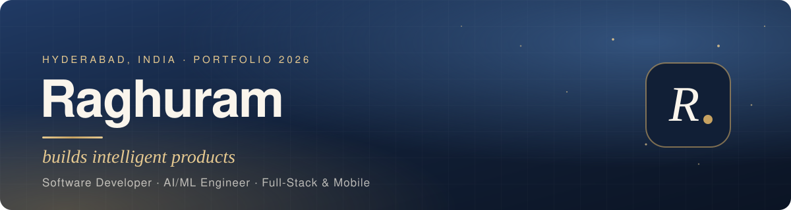

  

  
  
  

## Hi, I'm Raghuram 👋

I'm **Yandamuri Mohana Venkata Raghuram**, a final-year B.Tech Computer Science and Engineering (Honors) student at **KL University**, specializing in **Data Science and Big Data Analytics**.

I design and build full-stack web apps, mobile apps and AI-powered systems: practical software that solves real problems.

- 💼 **Software Development Intern** at **Juvion Labs Private Limited**
- 🧑‍🏫 Part-time **Data Structures & Algorithms Mentor** at **Smart Interviews**
- 🔬 Previously: research internships at **IIT Tirupati** and **NIT Warangal**

## ✨ Featured projects

| Project | What it does | Built with |
| :-- | :-- | :-- |
| **[Mercora AI](https://github.com/Raghuram1784/Mercora-AI)** · [live](https://mercora-ai.vercel.app) | Agentic commerce: shop by conversation, with explicit authorization before checkout and server-verified Razorpay payments | React · Express · Prisma · Groq · Razorpay |
| **[VanaDrishti](https://github.com/Raghuram1784/vanadrishti)** | AI wildlife surveillance and ranger decision support: person, vehicle and animal detection with zone-aware risk alerts | PyTorch · MegaDetector V6 · BioCLIP · FastAPI · React |
| **[MedAssist AI](https://github.com/Raghuram1784/MedAssist-AI)** | Clinical decision support: evidence-grounded differential assessment from patient presentations | BioClinicalBERT · FAISS · NetworkX · Groq · FastAPI |
| **[FlowTwin AI](https://github.com/Raghuram1784/FlowTwin-AI)** | Predictive workflow optimization: user journeys as a graph, bottleneck detection and abandonment risk | React · @xyflow/react · FastAPI · NetworkX · scikit-learn |
| **[Scan2Hire](https://github.com/Raghuram1784/Scan2Hire)** · [live](https://v0-kaizen-job-portal.vercel.app/) | QR-powered career portal: student assessments, a QR code for every job and AI fitment scoring | Next.js · React · Tailwind CSS · shadcn/ui |
| **[SAMORI](https://github.com/Raghuram1784/smart_food_app)** | AI-assisted, real-time food delivery for Hyderabad: one Flutter app for customers, restaurants, riders and admins | Flutter · NestJS · PostgreSQL · Socket.IO · Gemini |

## 🧰 Toolkit

  

  

**AI / ML:** Machine Learning · Deep Learning · NLP · LLMs · RAG · LangChain · FAISS · Transformers

## 🧭 Journey

| When | Where | Role |
| :-- | :-- | :-- |
| Sep 2026 – Present | Juvion Labs Private Limited, Hyderabad | Software Development Intern |
| Current | Smart Interviews | Data Structures & Algorithms Mentor (part-time) |
| May – Jul 2026 | IIT Tirupati | Research Intern, Full-Stack & AI/ML Development |
| Jun – Jul 2025 | NIT Warangal | Machine Learning Research Intern |

## 📫 Let's connect

I'm always happy to talk about AI products, full-stack engineering and interesting problems. Reach me on [LinkedIn](https://www.linkedin.com/in/ymvraghuram/).
